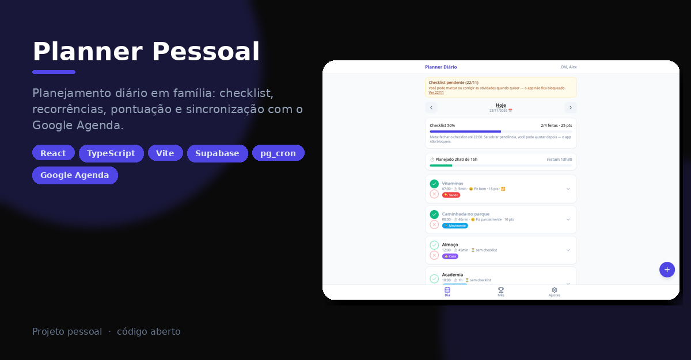
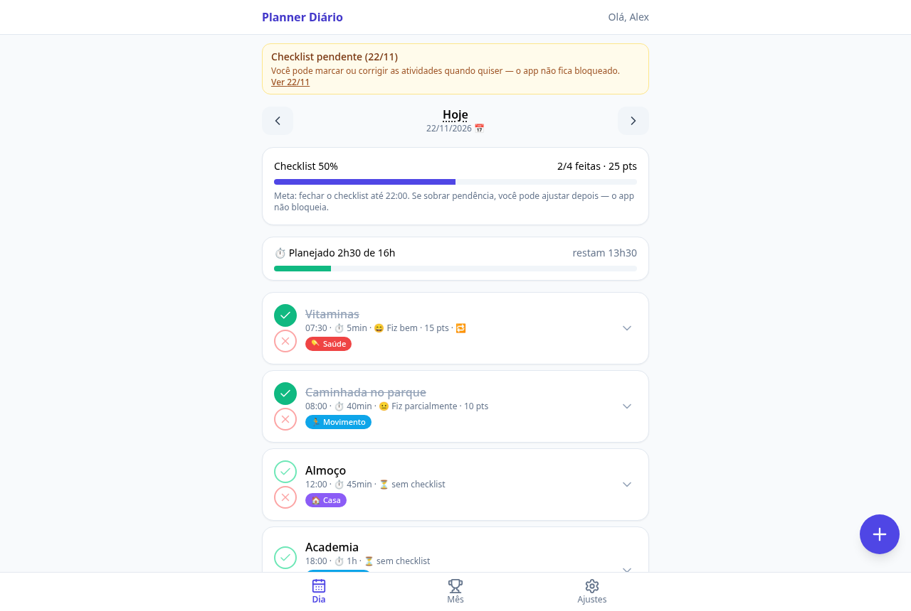
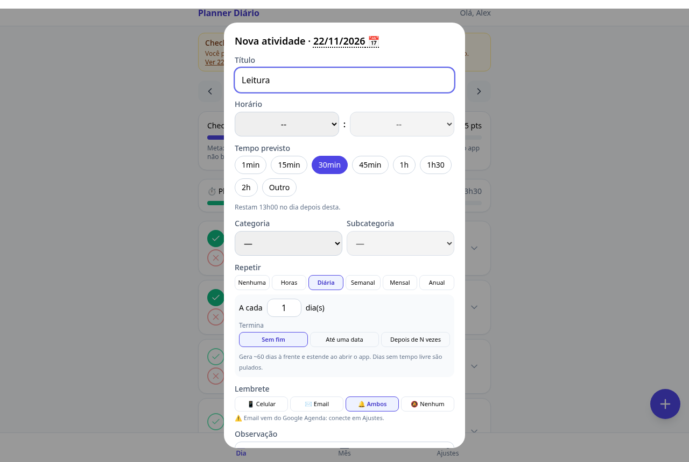
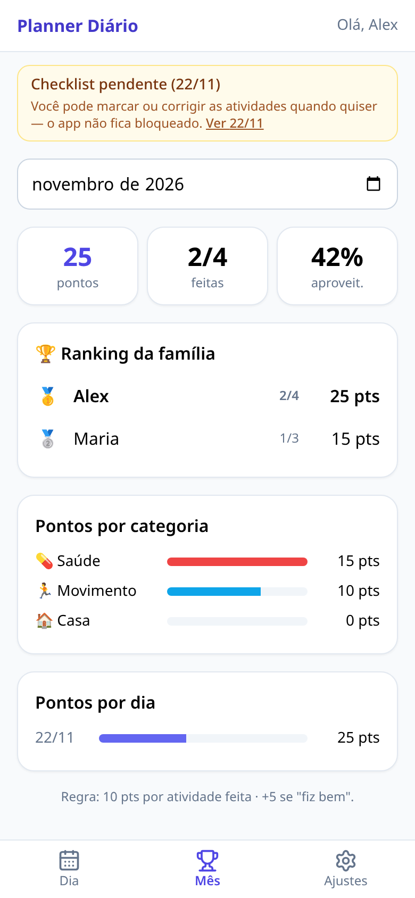
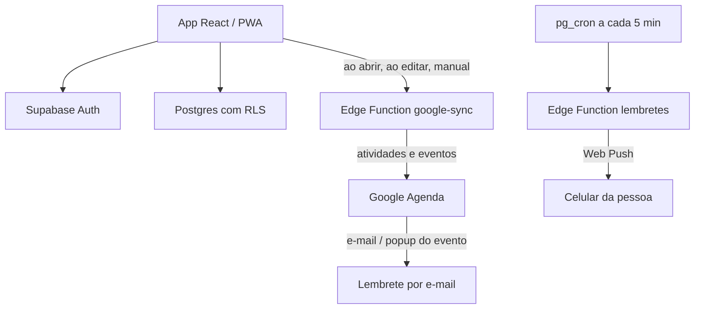

# Planner Pessoal

Projeto pessoal que comecei nas férias, pela necessidade de ter mais controle do meu tempo — e de um planner em português, com datas **dd/mm/aaaa**, que funcionasse no celular e no computador e pudesse ser compartilhado com a família.

O código está aberto (licença MIT) para quem quiser rodar no próprio ambiente. As telas abaixo usam **dados fictícios**.



| Dia e checklist (desktop) | Nova atividade / recorrência | Ranking do mês (celular) |
|---|---|---|
|  |  |  |

Mais telas (incluindo versões para celular) em [`docs/screenshots/`](docs/screenshots).

O app é um PWA (React + TypeScript + Vite + Tailwind) com **Supabase** (Auth, Postgres com Row Level Security e Edge Functions). Diferente do app de finanças, **não há modo 100% offline**: é preciso entrar com a conta.

## Funcionalidades

- 📅 **Dia:** lista do dia com horário, duração e categorias; criar, editar e apagar atividades.
- ✅ **Checklist do fim do dia:** cada item precisa de um status pessoal (não vale só “marcar como feito”). Atividades pendentes no fim do dia geram um **aviso**, mas **não bloqueiam** o app.
- 🔁 **Recorrência:** a cada X horas, diária, semanal, mensal ou anual — com “só esta ocorrência” ou “esta e as próximas”.
- 👨‍👩‍👧‍👦 **Família:** cada pessoa tem a própria conta; tarefas podem ser só suas ou compartilhadas (com a família inteira ou com pessoas escolhidas).
- 🏆 **Pontuação e ranking** mensal da família.
- 🔔 **Lembretes no celular** (Web Push) e, se o Google Agenda estiver conectado, lembrete por e-mail do próprio Google.
- 📆 **Sincronização com o Google Agenda:** o planner envia as atividades e importa os eventos da agenda (hoje até 14 dias à frente).
- 👤 **Perfil (Meu dia):** cada pessoa configura nome, início, duração e fim do dia, antecipação dos lembretes, notificações neste aparelho e a conexão com o Google Agenda (detalhes abaixo).
- 🌙 Tema claro, escuro ou automático; menu inferior no celular e lateral no computador. Instalável como **PWA**.

## Perfil (Meu dia)

Em **Ajustes**, cada pessoa configura o próprio perfil. Esses dados ficam na linha dela em `membros` e valem só para ela — o parceiro ou outro familiar tem o próprio conjunto.

### Meu dia

- **Nome:** como a pessoa aparece na família, no ranking e nas tarefas compartilhadas.
- **Início do dia:** horário em que o dia planejado começa.
- **Horas no dia:** duração planejada, de 1 a 24 horas. Ao criar uma tarefa compartilhada, a duração precisa caber no dia de **cada** participante.
- **Fim do dia (obrigatório):** horário de **fechamento do checklist**. O app avisa se ainda houver itens sem status nesse horário (e o lembrete de fim de dia dispara 30 minutos antes e no próprio horário).
- **Lembrar antes da atividade (min):** de 0 a 240 minutos. Esse valor é a antecedência dos avisos no celular **e** dos lembretes do evento no Google Agenda.

O fuso usado pelo app para “agora” e para o fechamento do dia vem do cadastro do membro (padrão `America/Sao_Paulo`). **Não há seletor de fuso em Ajustes** — o valor é o padrão do banco, a menos que seja alterado por outro meio.

### Integrações

- **Ativar notificações neste aparelho:** cadastra este navegador para **Web Push**. Sem essa ativação neste aparelho, o canal “celular” da atividade não chega aqui.
- **Google Agenda:** conectar, reconectar, desconectar e **Sincronizar agora**. Depois de conectado, o app mostra a data da última sincronização. Os lembretes por e-mail das atividades passam pelo Google Agenda (veja *Lembretes*), então é preciso conectar a agenda para usar o canal “e-mail”.

O canal do lembrete **não é um interruptor geral do perfil**. Em cada atividade a pessoa escolhe **celular**, **e-mail**, **ambos** ou **nenhum**. O canal é pessoal: na tarefa compartilhada, quem cria aplica a escolha na própria cópia; os demais começam em “ambos” e ajustam a sua.

### Família e participantes

Uma conta entra em **uma família** (não dá para participar de duas ao mesmo tempo). Quem cria a família vira administrador.

Em Ajustes, todos vêem a lista de participantes (com o horário de fim do dia de cada um). O **administrador** ainda pode:

- **Convidar:** WhatsApp, e-mail ou copiar o link (`?convite=CODIGO`), e também compartilhar pelo sistema do aparelho.
- Ver e **gerar um novo código** de 8 caracteres (o anterior deixa de valer).
- **Tornar admin**, **tirar admin** ou **remover** um membro. Precisa permanecer **pelo menos um administrador**.

O administrador também gerencia as **categorias** da família (nome, emoji, cor e subcategorias). *Sair da conta* encerra a sessão neste aparelho.

## Dia e checklist

Cada atividade tem título, data, horário, duração, categoria (e subcategoria), observação e canal de lembrete. **Não é possível criar atividade no passado.** O checklist, no entanto, pode ser preenchido ou corrigido no dia de hoje e em **dias já passados**.

Para o checklist, “checada” significa que a pessoa escolheu um **status pessoal** (não basta o visto de feito). No fim do dia, o que ainda estiver pendente gera aviso e os lembretes de fechamento; o app **não trava** o uso.

## Recorrências

Tipos: **a cada X horas**, **diária**, **semanal**, **mensal** ou **anual**. A série pode ter data de término, quantidade de ocorrências ou ficar **sem fim**.

O servidor materializa as ocorrências numa janela móvel de **60 dias** à frente (e recompõe quando necessário). Ao editar ou apagar, a pessoa escolhe:

- **Só esta** ocorrência.
- **Esta e as próximas** (as anteriores da série ficam como estavam). A exclusão em cadeia **não apaga** ocorrências que já tenham status pessoal preenchido.

## Tarefas compartilhadas

Uma atividade pode ser só da pessoa, da **família inteira** ou de **pessoas escolhidas** (quem cria entra automaticamente). Cada participante recebe a própria cópia, no próprio dia, respeitando a duração do dia dela.

Regras de edição, como o código faz hoje:

- Qualquer participante pode alterar os **campos comuns** (título, horário, data, observação, duração, categoria) e a alteração se propaga para as outras cópias.
- **Apagar a tarefa para todo mundo** continua sendo só de quem criou. Os demais podem **retirar a própria cópia**.
- O canal de lembrete e o checklist (status, pontos) são **pessoais**.

## Pontuação e ranking

A pontuação de cada atividade, aplicada quando a pessoa preenche o checklist:

| Situação | Pontos |
|---|---|
| Feito | **+10** |
| Feito e ainda marcou “fiz bem” | **+15** no total (+10 e +5) |
| Não feito, motivo “faltou tempo” ou “sem disposição” | **−5** |
| Não feito, motivo “mudei o plano” | **−2** |

O ranking do mês (e a tela do mês) usa essa pontuação, calculada no servidor (`ranking_mensal`). Só entra quem é da mesma família.

## Lembretes

Há dois caminhos **distintos** — um no celular, outro no Google Agenda. **Não há envio de e-mail pelo próprio app** (não há integração com serviço de e-mail transacional).

- **Celular (Web Push):** uma Edge Function (`lembretes`), disparada pelo **pg_cron a cada 5 minutos**, envia o aviso no navegador em que a pessoa ativou as notificações. Usa o horário da atividade menos os minutos do perfil, no fuso do membro. Se o canal da atividade for só “e-mail” ou “nenhum”, essa function **não** manda push. No fim do dia, avisa **30 minutos antes** e **no horário** de fechamento se ainda houver item sem checklist.
- **E-mail:** vem do **lembrete do evento no Google Agenda** (popup, e-mail ou ambos, conforme o canal), com a mesma antecedência configurada no perfil. Sem Agenda conectada, o canal “e-mail” não tem efeito.

## Google Agenda

A Edge Function `google-sync` (o token fica só no servidor, na tabela `google_tokens`):

- **Envia** para a Agenda as atividades com sincronização pendente, a partir de ontem.
- **Importa** os eventos da Agenda de **hoje até 14 dias à frente**. Eventos que o próprio planner criou (marcados com a propriedade privada `plannerId`) são ignorados na importação, para não duplicar. Os demais entram na tabela `eventos_google` e aparecem no dia.

A sincronização roda ao **abrir o app**, ao **voltar para a aba**, **alguns segundos depois de editar** e no botão **Sincronizar agora**. O arquivo padrão [`supabase/cron.sql`](supabase/cron.sql) agenda só os lembretes (a cada 5 minutos); um job extra de `google-sync` é opcional, se você quiser a agenda atualizada mesmo com o app fechado.

## Família e contas

Cada pessoa cria a **própria conta** (e-mail e senha). Quem cria a família vira administrador e convide os demais com o **código de 8 caracteres** ou o link `?convite=CODIGO` (há botão direto de WhatsApp, e-mail, copiar link e compartilhar). Uma pessoa só participa de **uma** família por conta.

Papéis:

- **Administrador:** convites, código novo, promover/rebaixar/remover, categorias da família. Não pode deixar a família sem nenhum admin.
- **Membro:** usa o próprio dia, o checklist, as tarefas compartilhadas e o ranking; não gerencia convites nem papéis.

As políticas de segurança ficam no Postgres (Row Level Security): cada um lê o que é da própria família.

## Arquitetura



## Stack

React 19, TypeScript, Vite, Tailwind CSS, Supabase (Auth, Postgres com RLS, Edge Functions em Deno, pg_cron), Web Push (VAPID), API do Google Calendar, vite-plugin-pwa. Testes de pontuação e regras em `scripts/test-regras.mjs` (não é Vitest).

## Como rodar

Precisa do [Node.js](https://nodejs.org) 20 ou superior e de um projeto no [Supabase](https://supabase.com) (o app não abre sem conta).

```bash
cp .env.example .env   # preencha as chaves do Supabase (e, se for usar, as do Google)
npm install
npm run dev        # http://localhost:5173
npm run build
npm run preview    # http://localhost:4173
npm test           # regras de pontuação, recorrência e checklist
```

### Instalar no celular

Publique o app (veja *Vercel* abaixo) e abra o link no aparelho:

- **Android (Chrome):** menu ⋮ → **Instalar app** (ou "Adicionar à tela inicial").
- **iPhone (Safari):** Compartilhar → **Adicionar à Tela de Início**. Para o Web Push no iPhone, o PWA precisa estar instalado na tela inicial.

### Supabase, uma vez só

1. Crie um projeto em [supabase.com](https://supabase.com) (região **South America (São Paulo)** é uma boa escolha). Guarde a senha do banco.
2. **SQL Editor:** rode, **na ordem**, todos os arquivos de [`supabase/migrations/`](supabase/migrations). Pode rodar de novo.
3. **Project Settings → API:** copie a **Project URL** e a chave **anon** / publishable para o `.env` (`VITE_SUPABASE_URL`, `VITE_SUPABASE_ANON_KEY`). **Nunca** coloque a `service_role` no frontend.
4. **Authentication → URL Configuration:** *Site URL* = endereço do app; em *Redirect URLs*, o mesmo endereço com `/**` (e `http://localhost:5173/**` para desenvolvimento).
5. **Edge Functions:** faça o deploy de [`supabase/functions/lembretes`](supabase/functions/lembretes) e, se for usar a Agenda, de [`supabase/functions/google-sync`](supabase/functions/google-sync).
6. **Web Push:** gere um par VAPID e coloque `VITE_VAPID_PUBLIC_KEY` no app e as chaves correspondentes nos secrets da function `lembretes`.
7. **Cron dos lembretes:** rode [`supabase/cron.sql`](supabase/cron.sql) no SQL Editor (dispara `lembretes` a cada 5 minutos). Exige a extensão `pg_cron` e o `pg_net`.
8. **Google Agenda (opcional):** crie credenciais OAuth no Google Cloud, configure as variáveis da function `google-sync` e as `VITE_GOOGLE_*` do app. Sem isso, o planner funciona normalmente; só não sincroniza a Agenda nem envia o lembrete por e-mail do Google.
9. Abra o app, crie a conta, crie a família e convide as outras pessoas.

O arquivo `.env.example` pode mencionar outras chaves de serviços que **não são usadas** pelo código atual dos lembretes. Siga só o que este README descreve.

### Vercel

[vercel.com](https://vercel.com) → *Add New → Project* → importe este repositório. A Vercel detecta **Vite** (`npm run build`, pasta `dist`). Cadastre as variáveis `VITE_SUPABASE_URL`, `VITE_SUPABASE_ANON_KEY` e, se for o caso, `VITE_VAPID_PUBLIC_KEY` e as do Google, depois faça o deploy.

A cada `git push` o site atualiza.

## Testes

```bash
npm test    # scripts/test-regras.mjs — pontuação, recorrência e regras do checklist
```

## Limitações

- **Não há modo 100% offline.** É preciso login e conexão para carregar e gravar as atividades.
- Uma conta participa de **uma** família. Para ter outra, é preciso outra conta.
- Não dá para criar atividade no passado (o checklist de dias passados pode ser preenchido ou corrigido).
- Lembrete por e-mail depende do **Google Agenda** conectado; o app não envia e-mail próprio.
- A importação da Agenda cobre **hoje até 14 dias à frente**. A materialização das recorrências cobre **60 dias** à frente.
- Web Push no iPhone exige o app instalado na tela inicial, e a pessoa precisa ativar as notificações naquele aparelho.
- O fuso do membro não é editável na tela de Ajustes (padrão `America/Sao_Paulo`).

## Licença

[MIT](LICENSE)
